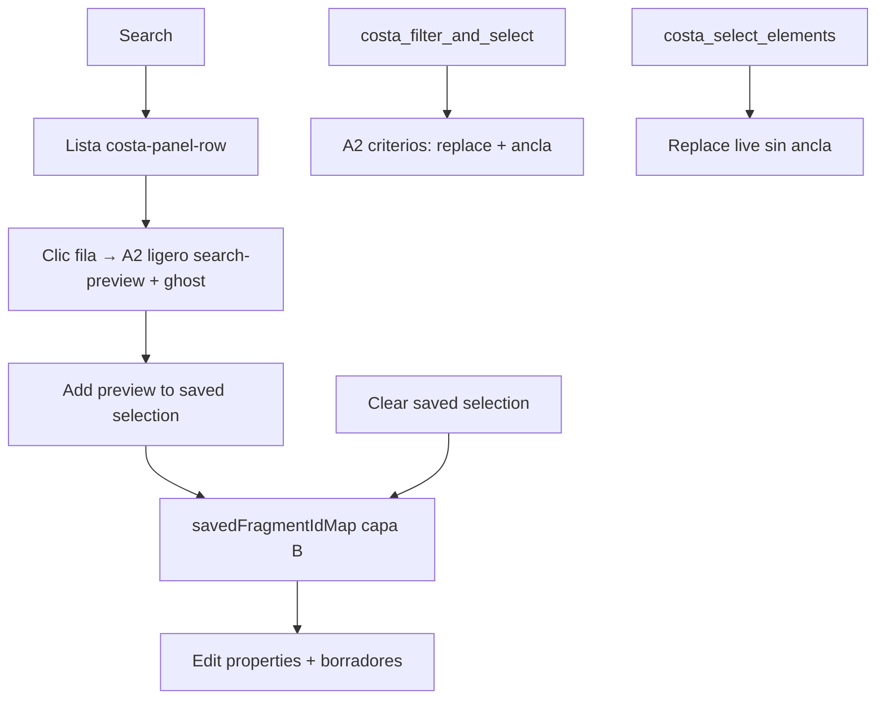

# Búsqueda de elementos y selección guardada

Complementa [PROPERTY_EDIT_GROUPED_EDIT_PROPOSAL.md](./PROPERTY_EDIT_GROUPED_EDIT_PROPOSAL.md).

## Objetivo

Unificar la búsqueda del panel **Element Search** con la lógica de MCP `costa_filter_and_select_elements`, limitar el coste de escaneo IFC y permitir acumular una **selección guardada** reutilizable en **Edit properties**.

## Implementación (código)

| Pieza | Ubicación |
|-------|-----------|
| Consulta IFC compartida | `src/utils/ifcElementQuery.ts` |
| WebSocket MCP | `src/bim_components/setup/websocket-client.ts` |
| UI búsqueda + cesta | `src/react-components/IFCViewer.tsx` |
| Lista compartida (filas Search/Groups) | `src/utils/costaPanelList.ts` + `.costa-panel-*` en `src/styles/style.css` |
| Selección viva (capa A) | `src/utils/viewerSelection.ts` (Highlighter seguro + ghost por transparencia de materiales) |
| Filtros / acciones Search (shell) | `src/styles/style.css` (clases `.search-*` de formulario, no de filas) |

## Filtros de búsqueda

| Campo UI | Comportamiento |
|----------|----------------|
| **IFC type** (dropdown, opcional) | Coincidencia exacta de tipo (`IfcBeam`, …). Lista generada al abrir el panel desde el modelo cargado. |
| **Keywords** | Substring en **Name** y **Description** (misma lectura `getProperties` por elemento). Mínimo 2 caracteres si no hay GUID ni solo tipo. |
| **GlobalId** | Coincidencia **exacta** (como MCP). |
| **Also search property names in Psets** | Opcional; recorre `IsDefinedBy` y nombres de propiedad (no valores). Más lento. |

Límites: hasta **500** coincidencias en escaneo (UI); MCP puede usar hasta **2000** vía `maxResults`.

## Flujo de selección

### Capas (producto)

1. **A2 ligero — Preview** (`search-preview`): un elemento; clic en fila. Misma fila visual que Groups (`costa-panel-row--active`). No es la cesta.
2. **B — Selección guardada** (`savedFragmentIdMap`): **Add preview to saved selection**. Fuente para Edit cuando la cesta no está vacía. Independiente del clic vacío del visor.
3. **A1 — Clic 3D** sin cesta: Edit sigue el live. Con cesta activa: View sigue el clic; Edit sigue la cesta.
4. **A2 criterios — MCP filter**: `applyViewerSelectionWithAnchor` (ancla ∪ resultado) cuando `replaceSelection` no es false.
5. **IDs explícitos — MCP select**: live = exactamente esos IDs (sin ancla).

Estado expuesto en consola: `window.costaSavedSelection`, `window.costaPropertyDraftStore.savedFragmentIdMap`.

### Estilos Highlighter registrados

| Style id | Uso |
|----------|-----|
| `cost-select` | Live / cesta aplicada / MCP por defecto |
| `search-preview` | Preview de una fila Search |

## MCP vs UI

| | MCP `costa_filter_and_select_elements` | MCP `costa_select_elements` | Panel Element Search |
|--|----------------------------------------|----------------------------|---------------------|
| Filtros | `ifcType`, `nameContains`, `globalId` | IDs explícitos | + keywords en Description; Psets opcional |
| Selección | Live A2 criterios (+ ancla si replace) | Replace live sin ancla | Preview A2 ligero + cesta B manual |
| `replaceSelection` | Sí | N/A (siempre replace) | Cesta independiente del clic 3D |

## Rendimiento

- Orden: tipo IFC → GUID → una `getProperties` → Name/Description → Psets solo si checkbox y no hubo match.
- Resultados ligeros (`IfcElementQueryRow`), sin guardar objetos IFC completos.
- Lista UI: máximo 100 filas visibles; el escaneo puede devolver hasta 500.

## Próximos pasos (diseño)

- Edición agrupada sobre `savedFragmentIdMap` ([PROPERTY_EDIT_GROUPED_EDIT_PROPOSAL.md](./PROPERTY_EDIT_GROUPED_EDIT_PROPOSAL.md)).
- Botón opcional «Add all results to saved» con confirmación y tope.
- `costa_get_viewer_selection` podría incluir flag `includesSavedBasket` si MCP debe leer la cesta.

## Deuda — barrer al cerrar Groups / Model-Selection

Acuerdo: **seguir con comportamiento ahora; barrer al cerrar** (antes del commit de paneles). Checklist:

| Ítem | Notas |
|------|--------|
| Código muerto | p.ej. `refreshMwStoreysList` / IDs `mw-tree-storeys-*` |
| Duplicación toolbar vs panel unificado | Groups + Search vs Model / Selection |
| CSS `!important` del tree | vs tipografía `.costa-panel-*` |
| Nombres `classifications*` / `mw-relations-*` | renombrar al cerrar |
| Fuera de ese commit | scripts sueltos; Fases 3–4 aplazadas |

## Costa groups Slice 1 (prueba reversible)

Ver [COSTA_GROUPS_SLICE1.md](./COSTA_GROUPS_SLICE1.md): Save = cesta ∪ live; documento `name` + `expressIds`; `localStorage` + `costaGroupsGetDocument()`.
