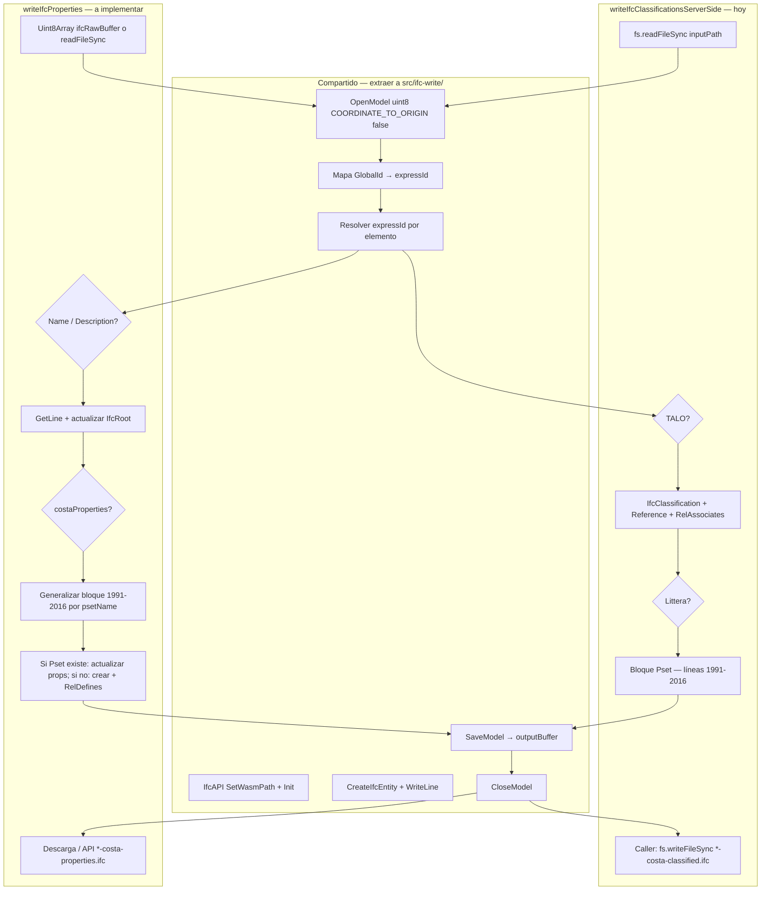

# Plan: guardar IFC modificado desde la app (Property Edit)

Documento de implementación futura. Describe cómo replicar el **único flujo que hoy genera una copia IFC válida** en el repo, aplicado a **Name / Description / propiedades Costa**, sin depender de Claude en tiempo de ejecución.

**Relacionado:** panel Edit (`propertyDraftStore`), selección guardada ([ELEMENT_SEARCH_AND_SAVED_SELECTION.md](./ELEMENT_SEARCH_AND_SAVED_SELECTION.md)), edición agrupada pendiente ([PROPERTY_EDIT_GROUPED_EDIT_PROPOSAL.md](./PROPERTY_EDIT_GROUPED_EDIT_PROPOSAL.md)).

---

## 1. Qué funciona hoy (referencia verificada)

La copia IFC **no se genera en el navegador**. El flujo que **sí** produce un archivo `.ifc` nuevo está en **`mcp-server/main.ts`**, función **`writeIfcClassificationsServerSide`** (TALO / Littera).

### Patrón Node + `web-ifc` (el que hay que copiar)

| Paso | Implementación actual |
|------|------------------------|
| 1 | `fs.readFileSync(inputPath)` — IFC fuente en **disco**, ruta absoluta |
| 2 | `new IfcAPI()` → `SetWasmPath(node_modules/web-ifc/)` → `Init()` |
| 3 | `OpenModel(uint8)` |
| 4 | Resolver `GlobalId` → `expressId` (mapa opcional) |
| 5 | Por cada elemento: `CreateIfcEntity` + `WriteLine` (mutaciones STEP) |
| 6 | `SaveModel(modelID)` → `Uint8Array` |
| 7 | `fs.writeFileSync(outPath, Buffer.from(outputBuffer))` |
| 8 | **Nunca** sobrescribir el original; nombre sugerido `{base}-costa-classified.ifc` |

Claude usa esto vía tool **`costa_write_ifc_classifications`** con `dryRun: false`:

- Registra ruta con **`costa_load_ifc`** → `lastLoadedIfcPath`.
- Escritura **solo en el proceso Node** del MCP server (líneas ~5350–5430).
- El **browser** en `websocket-client.ts` hace dry-run / escaneo; si llega `dryRun: false` al WS, responde error explícito: *debe manejarse en servidor*.

### Propiedades Costa (estado)

- Tool **`costa_write_ifc_properties`** y bridge **`costa_viewer_write_ifc_properties`** están registrados en `main.ts`.
- Importan **`./ifcPropertyWriter.js`**, pero **ese archivo no existe en el repositorio** (solo la referencia). La escritura de propiedades **no está implementada**; el patrón previsto es el mismo que clasificaciones.
- Spec: [MCP_IFC_WRITE_SPEC.md](./MCP_IFC_WRITE_SPEC.md) (sección propiedades).

### Datos en el visor (listos para Save)

- **`propertyDraftStore`**: borradores por `expressId`, `dirty`, `costaProperties[]`.
- **`getEditFragmentIdMap()`**: selección guardada (search) o highlight 3D.
- **`window.ifcRawBuffer`**: buffer del IFC cargado (ya se guarda al cargar modelo en `IFCViewer.tsx` y al cargar vía MCP).

**Falta:** botón Save, motor de escritura compartido, y entrega del archivo al usuario (descarga / “Guardar como”).

### 1.1 Equivalencias con `writeIfcClassificationsServerSide`

Esta sección enlaza el plan con el código que **hoy genera la copia IFC**. No es duplicar TALO/Littera: es reutilizar el **mismo esqueleto** para `writeIfcProperties`.

#### Flujo paso a paso (clasificaciones vs Property Save)



#### Tabla de correspondencia (líneas en `mcp-server/main.ts`)

| Paso | `writeIfcClassificationsServerSide` | `writeIfcProperties` (plan) |
|------|-------------------------------------|-----------------------------|
| Entrada IFC | `fs.readFileSync(inputPath)` ~1913–1915 | `openModelFromBytes(ifcRawBuffer)` **o** mismo `readFileSync` |
| Init WASM | 1908–1911 | **Igual** → `createIfcApi()` compartido |
| Abrir modelo | `OpenModel(uint8, { COORDINATE_TO_ORIGIN: false })` ~1915 | **Igual** |
| Mapa GUID | 1917–1929 | **Igual** → `buildGlobalIdMap(api, modelID)` |
| Resolver elemento | 1951–1958 | **Igual** (`expressId` o `globalIdMap`) |
| Mutación datos | TALO 1961–1988; Littera **1991–2016** | `name`/`description` en **IfcRoot** (nuevo); `costaProperties` → bloque Littera generalizado |
| Persistir | `SaveModel` 2029 | **Igual** |
| Cerrar | `CloseModel` 2030 | **Igual** |
| Retorno | `{ written, failed, errors, outputBuffer }` 2032 | **Misma forma** |
| Escribir disco | **Fuera** de la función (tool MCP ~5418+) | App: descarga / Save Picker; MCP: `writeFileSync` |

#### Plantilla de código: bloque Littera → `costaProperties`

El único bloque del writer actual que ya escribe **Property Sets Costa** es el de Littera. Copiarlo como base y parametrizar nombres:

```1991:2016:mcp-server/main.ts
      if (el.litteraCode) {
        const props: any[] = [];
        const makeProp = (name: string, val: string) =>
          api.CreateIfcEntity(modelID, IFC_PROPERTY_SINGLE_VALUE,
            ifcLabel(name), null, { type: 1, value: val }, null);
        const p1 = makeProp("COSTA LITTERA", el.litteraCode);
        api.WriteLine(modelID, p1);
        props.push({ type: 5, value: p1.expressID });
        // ... más props fijas ...
        const pset = api.CreateIfcEntity(modelID, IFC_PROPERTY_SET,
          ifcLabel(ifcMakeGuid()), null, ifcLabel("Pset_CostaClassification"), null, props);
        api.WriteLine(modelID, pset);
        const relPset = api.CreateIfcEntity(modelID, IFC_REL_DEFINES_BY_PROPERTIES,
          ifcLabel(ifcMakeGuid()), null, null, null,
          [{ type: 5, value: expressId }],
          { type: 5, value: pset.expressID });
        api.WriteLine(modelID, relPset);
      }
```

**Generalización prevista en `writeIfcProperties`:**

| En Littera (fijo) | En Property Save (dinámico) |
|-------------------|-----------------------------|
| `makeProp("COSTA LITTERA", el.litteraCode)` | `makeProp(propertyName, value)` por cada entrada en `costaProperties[]` |
| `ifcLabel("Pset_CostaClassification")` | `ifcLabel(psetName)` del borrador (`costa_*`, `Pset_Costa_*`, etc.) |
| Siempre **crea** Pset + relación nueva | **Fase 1 mínima:** igual que Littera (crear). **Fase 1+:** si el elemento ya tiene ese Pset vía `IfcRelDefinesByProperties`, actualizar `NominalValue` o añadir props al Pset existente |
| Solo corre si `el.litteraCode` | Solo props incluidas en payload `dirty` |

**Name / Description:** no existen en clasificaciones. Añadir en el mismo bucle `for (const el of elements)`:

1. `api.GetLine(modelID, expressId, true)` (o `false` según API).
2. Asignar `line.Name` / `line.Description` con `ifcLabel(...)` si vienen en el payload.
3. `api.WriteLine(modelID, line)` para persistir el cambio en el modelo abierto.

#### Qué extraer a `src/ifc-write/` (Fase 0)

| Símbolo / lógica | Origen aprox. | Módulo destino |
|------------------|---------------|----------------|
| `createIfcApi()`, `SetWasmPath(REPO_ROOT/node_modules/web-ifc/)` | 1908–1911 | `ifcApi.ts` |
| `openModelFromPath` / `openModelFromBytes` | 1913–1915 | `openModel.ts` |
| `buildGlobalIdMap` | 1917–1929 | `globalIdMap.ts` |
| `resolveExpressId(el, map)` | 1951–1958 | `resolveElement.ts` |
| `ifcLabel`, `ifcMakeGuid`, `IFC_*` | imports/helpers en `main.ts` | `ifcStepHelpers.ts` |
| Bloque Pset + relación | 1991–2016 | `writeCostaPsetForElement.ts` (parametrizado) |
| `SaveModel` + retorno stats | 2029–2032 | `finalizeModel.ts` |

`writeIfcClassificationsServerSide` queda como **orquestador** que importa lo compartido + lógica TALO (1961–1988). `writeIfcProperties` importa lo mismo + Name/Description + Pset generalizado.

#### Diferencias deliberadas (no son bugs del plan)

| Tema | Clasificaciones | Property Save |
|------|-----------------|---------------|
| Payload | `taloCode`, `litteraCode`, … | `name`, `description`, `costaProperties[]` |
| Fuente en app | Solo path en servidor MCP | `window.ifcRawBuffer` prioritario |
| Nombre archivo | `*-costa-classified.ifc` | `*-costa-properties.ifc` |
| Actualizar entidades existentes | No (siempre crea refs/psets nuevos) | Sí para Name/Description y, en fase avanzada, props en Pset existente |

---

## 2. Principio de diseño

> **La app Costa debe usar el mismo motor que genera la copia IFC (Node + `web-ifc` + `SaveModel`), no el protocolo MCP ni Claude.**

| Sí | No |
|----|-----|
| Módulo Costa reutilizable de escritura IFC | Llamar a `costa_write_ifc_properties` desde el visor |
| Servicio local / API del propio proyecto (opcional) | Depender de que `mcp-server` esté levantado para guardar |
| Entrada: bytes del IFC fuente + payload de cambios | Reescribir solo fragments en memoria (no persiste IFC) |
| Salida: archivo nuevo + recarga en visor | Sobrescribir IFC original sin confirmación |

Claude, si está conectado, puede seguir usando el **mismo módulo** importado desde `mcp-server`; es un consumidor más, no el único camino.

---

## 3. Arquitectura objetivo

```text
┌─────────────────────────────────────────────────────────────┐
│  IFCViewer — Edit tab                                         │
│  propertyDraftStore (dirty) + getEditFragmentIdMap()          │
│  [Save to IFC] → build IfcPropertyWritePayload[]              │
└───────────────────────────┬─────────────────────────────────┘
                            │
                            ▼
┌─────────────────────────────────────────────────────────────┐
│  Costa IFC Writer (nuevo, fuera de MCP)                       │
│  src/ifc-write/                                               │
│    openModelFromBytes(buffer) | openModelFromPath(path)       │
│    writeIfcProperties(model, elements[])                      │
│    saveToBuffer() → Uint8Array                                │
└───────────────────────────┬─────────────────────────────────┘
                            │
              ┌─────────────┴─────────────┐
              ▼                           ▼
   App: descarga / File System API    (opcional) mcp-server importa
   + IfcLoader.load(nuevo buffer)      el mismo módulo para tools
```

### Fuente del IFC de entrada

| Origen de carga | Hoy | Para Save |
|-----------------|-----|-----------|
| Toolbar `loadIfc` | `ifcRawBuffer` en memoria | Usar **`ifcRawBuffer`** como entrada del writer |
| MCP `costa_load_ifc` | Buffer + `lastLoadedIfcPath` en servidor | App: solo buffer; path en servidor es irrelevante para Save en app |
| Sin buffer guardado | — | Deshabilitar Save o pedir “volver a cargar archivo” |

**Recomendación:** API del writer que acepte **`Uint8Array`** (no exigir path en cliente). En Node, escribir salida a temp o devolver bytes en HTTP.

---

## 4. Payload de escritura (desde UI)

Alinear con borrador y con spec existente:

```ts
type IfcPropertyWriteInput = {
  expressId?: number;
  globalId?: string;
  name?: string;
  description?: string;
  costaProperties?: Array<{
    psetName: string;      // ej. costa_ o Pset_Costa_*
    propertyName: string;
    value: string;
  }>;
};
```

### Reglas al construir payload desde `propertyDraftStore`

1. Solo elementos **`dirty`** en la selección efectiva (`getEditFragmentIdMap()`).
2. Incluir `expressId` y `globalId` cuando existan.
3. Propiedades Costa: usar `psetName`, `propertyName`, `value` del borrador (incl. `isNew`).
4. No enviar elementos sin cambios.

### Semántica IFC (implementar en writer)

| Campo | Acción esperada |
|-------|-----------------|
| `name` / `description` | Actualizar atributos IfcRoot del elemento |
| `costaProperties` | IfcPropertySet + IfcPropertySingleValue; crear relación `IfcRelDefinesByProperties` si no existe |
| Pset nuevo | Crear Pset y relación (misma idea que `Pset_CostaClassification` en clasificaciones) |
| Valores | `IfcPropertySingleValue` con tipo texto / medida según convención Costa |

Detalle de entidades STEP: implementar en `writeIfcProperties` tomando como plantilla los bloques de `writeIfcClassificationsServerSide` (CreateIfcEntity, WriteLine, guids).

---

## 5. Entrega del archivo al usuario

| Paso | Comportamiento |
|------|----------------|
| Nombre salida | `{nombreOriginal}-costa-properties.ifc` (o elegido en diálogo) |
| Original | No modificar |
| Tras éxito | `IfcLoader.load(nuevoBuffer)` + reindexar (`IfcRelationsIndexer`, `Classifier`) + limpiar `dirty` / aviso |
| Errores | `{ written, failed, errors[] }` por elemento; UI muestra resumen |

### Recarga del visor

Tras guardar, los `expressId` pueden cambiar. Plan:

1. Cargar IFC exportado como modelo nuevo (reemplazar `fragmentModel`).
2. Vaciar o remapear `propertyDraftStore.drafts` (mejor vaciar y re-sync al seleccionar).
3. Mantener `savedFragmentIdMap` solo si los GlobalId siguen válidos (preferible limpiar cesta y pedir nueva selección).

---

## 6. Cómo invocar el writer desde la app (opciones)

### Opción A — Servicio local Costa (recomendada para paridad con MCP)

- Nuevo entry: p. ej. `scripts/costa-ifc-write-service.ts` o plugin Vite en `scripts/dev.cjs`.
- Endpoint: `POST /api/costa/write-ifc-properties`
  - Body: `{ sourceIfc: base64|bytes, elements: IfcPropertyWriteInput[], outputFilename? }`
  - Response: archivo IFC (binary) + JSON stats.
- **Pros:** Mismo `web-ifc` WASM de Node que clasificaciones; sin duplicar lógica en browser.
- **Contras:** Proceso Node al desarrollar (aceptable: es parte del producto, no MCP).

### Opción B — `web-ifc` en el navegador

- Portar lógica de escritura a WASM en el cliente.
- **Pros:** Un solo proceso.
- **Contras:** Duplicación respecto a Node; más RAM; hay que validar que `SaveModel` en browser produzca el mismo IFC que Node (clasificaciones no validan esto hoy en cliente).

### Opción C — Proceso hijo CLI

- `node scripts/write-ifc-properties.mjs --input --payload --output`
- La app dispara el script vía no aplica en web pura.

**Decisión sugerida para el plan:** **Opción A** + extraer módulo compartido; **Opción B** solo si se exige despliegue sin Node.

---

## 7. Plan de implementación por fases

### Fase 0 — Extraer referencia que funciona

- [ ] Crear `src/ifc-write/` (o `shared/ifc-write/`).
- [ ] Mover o copiar utilidades de `writeIfcClassificationsServerSide`:
  - init API, open from path **y** from bytes
  - mapa GlobalId
  - helpers `ifcLabel`, `ifcMakeGuid`, constantes IFC usadas
- [ ] Refactor `mcp-server/main.ts` para importar desde ahí (sin cambiar comportamiento Claude).
- [ ] Tests manuales: un IFC pequeño, una clasificación, comparar archivo salida con flujo actual.

### Fase 1 — `writeIfcPropertiesServerSide`

- [ ] Implementar `src/ifc-write/writeIfcProperties.ts` (sustituye `ifcPropertyWriter.js` fantasma).
- [ ] Partir del bloque **§1.1** (líneas 1991–2016) → `writeCostaPsetForElement`; luego Name/Description en IfcRoot.
- [ ] Casos: actualizar Name/Description; añadir/actualizar propiedades en Pset Costa existente; crear Pset nuevo.
- [ ] Tests: 1 elemento, N elementos, elemento inexistente, dry-run interno (validar sin SaveModel).
- [ ] Export: `{ written, failed, errors, outputBuffer }`.

### Fase 2 — Servicio / API Costa (app)

- [ ] Endpoint o función invocable desde `IFCViewer` con `ifcRawBuffer` + payload.
- [ ] Respuesta: bytes + metadata.
- [ ] UI: botón **Save to IFC** en pestaña Edit (deshabilitado si no hay dirty o no hay `ifcRawBuffer`).
- [ ] Confirmación si `dirty` > N o sin selección guardada.

### Fase 3 — Post-save en visor

- [ ] Recargar modelo desde buffer exportado.
- [ ] Actualizar `ifcRawBuffer` al nuevo archivo (para siguientes saves encadenados).
- [ ] Reset borradores / mensaje de éxito con ruta o nombre de archivo.
- [ ] Opcional: “Guardar como” con File System Access API / descarga.

### Fase 4 — Integración opcional MCP

- [ ] `mcp-server` importa `writeIfcProperties` del módulo compartido (eliminar import roto).
- [ ] Mantener tools Claude sin cambios de contrato.

### Fase 5 — Calidad

- [ ] IFC de prueba Revit / Archicad / Tekla (abrir en visor origen, solo cambio Name + una prop `costa_`).
- [ ] Verificar que geometría no cambia (solo datos).
- [ ] Documentar en este archivo resultados y límites conocidos.

---

## 8. UI / producto (sin mencionar Claude)

Textos sugeridos:

- Botón: **Save to IFC** / **Guardar IFC**
- Ayuda: “Genera un nuevo archivo IFC; el original no se modifica.”
- Progreso: “Writing N properties…”
- Éxito: “Saved as `model-costa-properties.ifc`. Reloading model…”

---

## 9. Riesgos y mitigaciones

| Riesgo | Mitigación |
|--------|------------|
| Modelo grande → Save lento | Progreso + solo dirty; límite opcional de elementos por lote |
| `ifcRawBuffer` desactualizado respecto a fragments | Tras ediciones solo en memoria, buffer sigue siendo fuente STEP correcta; tras Save, reemplazar buffer |
| Psets Costa con nombres distintos (`costa_` vs `Pset_Costa`) | Misma función `isCostaIfcPsetName` que el panel Edit |
| Writer duplicado MCP vs app | Un solo módulo `src/ifc-write` |
| ExpressID cambian tras Save | Recarga completa; no reutilizar drafts viejos |

---

## 10. Fuera de alcance (esta entrega)

- Edición agrupada en UI (ver proposal aparte).
- Escritura IFC solo desde browser WASM (salvo que A falle).
- Sobrescritura del IFC original.
- Sincronización automática con CostPage / Excel.

---

## 11. Criterios de aceptación

1. Usuario carga IFC en Costa, edita Name/Description/Costa en Edit, pulsa **Save to IFC** **sin Claude conectado**.
2. Se descarga o guarda un **nuevo** `.ifc` y el visor recarga ese archivo.
3. Al reabrir el IFC exportado (Costa u otro visor), se ven los valores escritos.
4. El archivo original en disco no cambia.
5. Errores parciales se reportan sin corromper el archivo completo (0 escritos → no generar salida o rollback claro).

---

## 12. Referencias de código

| Qué | Dónde |
|-----|--------|
| Writer que funciona (clasificaciones) | `mcp-server/main.ts` → `writeIfcClassificationsServerSide` (~1891–2032) |
| Escritura real Claude | `costa_write_ifc_classifications` tool, `dryRun: false` (~5350–5430) |
| Browser no escribe IFC | `websocket-client.ts` ~2560–2572 |
| Buffer fuente en app | `IFCViewer.tsx` → `ifcRawBuffer` |
| Borradores Edit | `IFCViewer.tsx` → `propertyDraftStore` |
| Spec propiedades | `docs/MCP_IFC_WRITE_SPEC.md` |
| Import roto | `mcp-server/main.ts` línea 13 → `./ifcPropertyWriter.js` |

---

*Última revisión: añadida §1.1 (equivalencias, diagrama, plantilla 1991–2016). `ifcPropertyWriter` sigue ausente; patrón válido = Node `web-ifc` SaveModel como en clasificaciones.*
